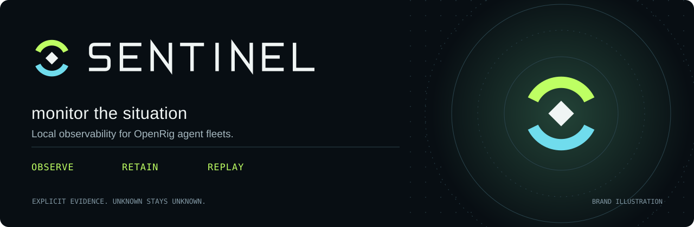

<div align="center">



<h1>SENTINEL <small>monitor the situation</small></h1>

**Know what your agents are doing. Know what you don't know.**

A local observability companion for OpenRig-managed agent fleets.
Observe sampled activity, retain metadata, and replay what was received.

[](https://pypi.org/project/sentinel-openrig/)
[](https://github.com/OOOffsite/sentinel/releases/tag/v0.4.0)
[](pyproject.toml)
[](docs/reference/contracts.md)
[](docs/STATUS.md)
[](pyproject.toml)

[](https://github.com/OOOffsite/sentinel/actions/workflows/ci.yml)
[](LICENSE)

[Website & live preview](https://oooffsite.github.io/sentinel/) · [Get started](docs/guides/getting-started.md) · [Documentation](docs/index.md) · [Wiki](docs/wiki/index.md) · [API reference](docs/reference/api.md) · [Status](docs/STATUS.md)

</div>

---

## See the signal

Sentinel gives operators a grounded view of an OpenRig fleet without taking over agent control. It receives a defined OTLP JSON subset from the existing upstream exporter, stores allowlisted metadata in SQLite, and serves a local dashboard and read API.

| Capability | What you get |
| :--- | :--- |
| **Observe** | Project rosters, verified seat bindings, and sampled presence/activity with freshness checks. |
| **Retain** | A local metadata journal with normalized duplicate suppression. No prompt, transcript, or message-body capture. |
| **Replay** | Cursor-based history and snapshots of what the receiver had observed. |
| **Stay honest** | Stale, missing, unsupported, or unverified evidence remains unknown. |
| **Prepare** | A separate project CLI validates declarations and produces a reviewable preparation plan. Applying that plan is explicit. |

```text
OpenRig → pinned upstream exporter → Sentinel → local dashboard / read API
                                      │
                                      └── SQLite metadata journal
```

OpenRig remains the agent and queue authority. Sentinel does not launch agents, enqueue work, or infer who messaged whom. The legacy simulation is a separate, labeled view.

## Requirements

| Dependency | Required for | Installed by pip? |
| --- | --- | --- |
| Python 3.11+ | Sentinel itself | No; provide a Python runtime. |
| **OpenRig** | **Real fleet telemetry and managed agents** | No; install and verify separately. |
| Node.js 22/24 | The upstream telemetry exporter | No; install separately. |
| Pinned `openrig-telemetry` exporter | Sending supported observations to Sentinel | No; reviewed separately. |
| Git | Exporter checkout and project preparation | No; install separately. |

Zero third-party Python runtime dependencies does not mean zero system requirements. An empty local monitor can run without OpenRig; observing a real fleet requires it.

## Quick start

**Requires Python 3.11+.** Git is needed for project preparation. Actual telemetry also requires separately installed OpenRig and Node.js 22/24 for the upstream exporter.

Install the `0.4.0` alpha release in a project-local virtual environment:

```bash
python3 -m venv .venv
. .venv/bin/activate
python -m pip install sentinel-openrig==0.4.0
sentinel-openrig --help
sentinel-project --help
```

This is a **Python package**. OpenRig and its Node.js exporter are installed separately. To install from a source checkout, run `python -m pip install .` at the repository root; build isolation may download setuptools. Reviewed wheel assets also support an offline install with `--no-deps --no-index`.

Next, follow [getting started](docs/guides/getting-started.md) to declare a small roster, initialize a local configuration, and understand the empty dashboard before connecting verified telemetry. For project worktrees and AgentSpecs, use [project preparation](docs/guides/project-setup.md).

## Designed around evidence

- **Local by design.** The receiver binds to loopback and trusts the local OS account. It is not an authenticated remote gateway.
- **Explicit identity.** Bind an immutable exported node ID to a declared seat only with authoritative host evidence.
- **Freshness matters.** A recent receipt, a running process, and advancing source telemetry are different facts.
- **Replay has limits.** Journal order is receipt order, not proof of source causality or complete history.
- **Simulation stays separate.** Illustrations and the legacy Atlas simulation never stand in for missing observations.

Read the [observation model](docs/wiki/observation-model.md) and [security boundary](docs/SECURITY.md) before operating the receiver.

## Explore the documentation

| Start here | Go deeper |
| :--- | :--- |
| [Getting started](docs/guides/getting-started.md) | [Architecture and data flow](docs/wiki/architecture.md) |
| [Operations and exporter setup](docs/guides/operations.md) | [CLI reference](docs/reference/cli.md) |
| [Project preparation](docs/guides/project-setup.md) | [HTTP API](docs/reference/api.md) |
| [Wiki and FAQ](docs/wiki/index.md) | [Schemas, types, and specifications](docs/reference/contracts.md) |
| [GitHub Pages publishing](docs/guides/github-pages.md) | [Integration decision / ADR-S01](docs/INTEGRATION.md) |

The marketing site and documentation share one static GitHub Pages build. The wiki lives in this repository so the same content is reviewable on GitHub and readable on the site. See [site source](site/index.html) and the [publishing guide](docs/guides/github-pages.md). Explore the [published site and interactive application preview](https://oooffsite.github.io/sentinel/). Release artifacts are available on [GitHub](https://github.com/OOOffsite/sentinel/releases/tag/v0.4.0) and [PyPI](https://pypi.org/project/sentinel-openrig/0.4.0/).

## Development

Use an isolated development environment with the optional test and documentation dependencies:

```bash
python -m pip install -r requirements-dev.txt -r requirements-docs.txt
python tests/test_module.py
python tools/build_site.py --check
```

The module suite covers schemas, ingestion, replay, freshness, identity/configuration constraints, local HTTP behavior, and skill projection. These fixture tests do not establish interoperability with a real OpenRig deployment. [Contributing](docs/CONTRIBUTING.md) explains the workflow; [status and validation](docs/STATUS.md) records the boundaries.

## Status and compatibility

| Component | Current baseline |
| :--- | :--- |
| Sentinel package | `0.4.0` — local prototype |
| Observation contract | `1.1.0` |
| Preserved simulation contract | `1.0.0` |
| OpenRig documentation reviewed | `0.7.21`; verify the installed CLI separately |
| Exporter pin | [`1beecce…`](https://github.com/smota/openrig-telemetry/tree/1beecce96befec880a93f60b11d83b44d7347620) |

Before production, test the exact pinned exporter and installed OpenRig version. Sustained capacity, retention, and remote deployment are not validated. The 128-seat ceiling is an implementation limit, not a performance claim. Static badges describe declared metadata. The CI badge reports GitHub workflow state and may show no run until the initial push; neither is a production-readiness certificate.

## Contributing and licensing

Bug reports should include reproducible steps, versions, and synthetic fixtures. Keep private payloads and runtime journals out of public issues. Read [contribution guidance](docs/CONTRIBUTING.md) and [security reporting](docs/SECURITY.md).

Licensed under [Apache-2.0](LICENSE). The upstream exporter is a separate Apache-2.0 project. See the [brand guide](docs/brand/style-guide.md) for identity and asset usage.
