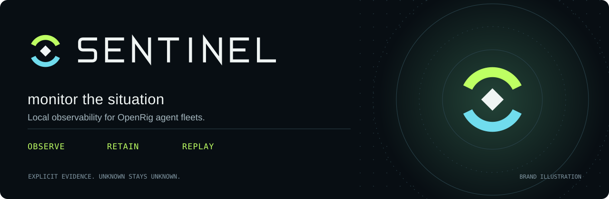

# Sentinel brand guide

Version **1.0.0** · November 24, 2026

Sentinel makes the boundary of observation visible. Its identity pairs a precise open aperture with a bright central signal: evidence can be clear without pretending the picture is complete.



## Identity and naming

Use **SENTINEL** as the display name and in the brand lockup. “Sentinel” is acceptable in running prose. Use **Sentinel OpenRig** when context must distinguish the product from other projects. Use `sentinel-openrig` for the Python package and receiver command, and `sentinel-project` for the separate preparation command. The target repository is `OOOffsite/sentinel`.

The primary tagline is exactly **monitor the situation**, in lowercase and without terminal punctuation. Pair it below or alongside the uppercase **SENTINEL** name at a smaller size. “See the signal. Keep the truth.” may remain explanatory section copy, but is not the primary tagline. Supporting language is direct and factual: “Local observability for OpenRig agent fleets,” “Explicit evidence,” and “Unknown stays unknown.” Prefer verbs such as observe, retain, replay, inspect, and verify. Avoid claims of autonomous control, real-time completeness, production certification, or universal agent compatibility.

## The open aperture

The symbol has two open arcs around a central diamond. The arcs describe the perimeter of observation; the visible gaps preserve uncertainty. The diamond is a brand element, not a status light. Neither the mark nor the concentric reference rings represents messages moving between agents.

The mark is original geometric artwork created for this repository. It is not the provisional hexagon/S symbol used during the initial site layout.


### Construction

The master uses a `64 × 64` viewBox. Its center is `(32, 32)`, its outer radius is 26 units, and its inner radius is 18 units. Upper and lower sectors span `−154°…−26°` and `26°…154°`. The center diamond is 18 units from tip to opposite tip. These proportions, arc angles, and open sides are fixed.

The wordmark is a custom outlined geometric alphabet supplied as SVG paths. It has no font-loading dependency. The full lockup combines the symbol, a fixed gap, and **SENTINEL**; do not retype it to imitate the artwork.

### Clear space and minimum size

Keep at least **16 master units** of clear space around the 64-unit mark, equivalent to one quarter of its displayed width. For the full lockup, use one quarter of the displayed mark width as clear space on every side. Typography, borders, and photographs should stay outside that area.

Use the symbol at **24 CSS pixels or larger** in an interface. The dedicated favicon is the exception: it remains intentionally simplified by size and has its own ink tile. Use the full wordmark lockup at **170 CSS pixels or larger**. At smaller widths use the symbol with an accessible product name in surrounding text.

### Dark, light, and monochrome

| Background | Asset | Rule |
| --- | --- | --- |
| Ink or dark surface | [mark-dark.svg](../../site/assets/brand/mark-dark.svg), [wordmark-dark.svg](../../site/assets/brand/wordmark-dark.svg) | Lime upper arc, cyan lower arc, off-white center and letters. |
| White or a very light neutral | [mark-light.svg](../../site/assets/brand/mark-light.svg), [wordmark-light.svg](../../site/assets/brand/wordmark-light.svg) | Solid ink geometry. Bright brand colors do not provide enough contrast on white. |
| One-color dark print | [mark-mono.svg](../../site/assets/brand/mark-mono.svg) | Solid ink; preserve the cutouts. |
| One-color reversed print | [mark-white.svg](../../site/assets/brand/mark-white.svg) | Off-white on a sufficiently dark solid field. |
| Browser or app icon | [favicon.svg](../../site/assets/brand/favicon.svg), [app-icon.png](../../site/assets/brand/app-icon.png) | Use the supplied ink tile rather than adding a new shape. |

Do not add a shield, rotate the mark, stretch its width, close the aperture gaps, replace the center diamond with a status dot, or independently recolor its parts. Do not place it over visually busy content without a solid field. Do not apply a glow, gradient, shadow, or outline to the core mark. Soft glows and rings belong to large illustration compositions only.

## Color system

| Token | Hex | Use |
| --- | --- | --- |
| Ink | `#080e13` | Primary dark canvas and text on bright surfaces. |
| Surface | `#0e181f` | Secondary dark reading areas. |
| Raised surface | `#14222b` | Elevated controls and code framing. |
| Text | `#f0f5f4` | Headings and high-priority body text. |
| Muted | `#a5b7bf` | Supporting copy. |
| Dim | `#8096a2` | Secondary metadata on ink. |
| Signal lime | `#beff63` | Primary action, brand emphasis, upper aperture arc. |
| Signal cyan | `#70dced` | Links, keyboard focus, lower aperture arc. |
| Graphic cyan | `#59d7e9` | Existing thin illustrative detail; prefer Signal cyan for text. |
| Rule | `#273a44` | Decorative separators, not the sole indicator of a control boundary. |

Use dark surfaces for the primary product identity. Reserve lime for emphasis rather than large amounts of paragraph text. Pair cyan links with an underline or another visible link cue. Do not use the color palette alone to convey current evidence state.

### Measured contrast

These ratios were calculated with the WCAG sRGB relative-luminance formula for solid color pairs. They are not an audit of every composed page, font size, image, or interaction.

| Foreground / background | Ratio | Guidance |
| --- | --- | --- |
| Text / Ink | 17.62:1 | Main text. |
| Muted / Ink | 9.35:1 | Supporting text. |
| Dim / Ink | 6.28:1 | Secondary text; do not reduce opacity. |
| Signal lime / Ink | 16.33:1 | Emphasis and labels. |
| Signal cyan / Ink | 12.15:1 | Links and focus indicators. |
| Ink / Signal lime | 16.33:1 | Primary-button text. |
| Ink / White | 19.40:1 | Light-surface typography. |
| Signal lime / White | 1.19:1 | Do not use for text or essential UI information. |
| Signal cyan / White | 1.60:1 | Do not use for text or essential UI information. |

For new color pairs, measure the actual pair. Normal text should reach 4.5:1; large text and qualifying non-text information should reach 3:1. Preserve native forced-color behavior and test it separately.

## Typography

The logo's outlined wordmark is artwork. Interface and documentation copy should remain selectable HTML text, never rasterized branding.

Use the existing site stack for the interface: `Inter, "Helvetica Neue", Arial, sans-serif`. Inter is a local optional preference; the site does not fetch a font. Use `"SFMono-Regular", Consolas, "Liberation Mono", monospace` for compact technical labels, commands, and identifiers. Do not make body copy monospaced.

Aim for 16px or larger body text, 14px or larger frequent labels, and a comfortable 1.6–1.85 line height in prose. Use large, closely spaced display headlines selectively. Documentation headings should help readers scan, while code and tables retain horizontal overflow within their own containers. Respect browser text scaling.

## Layout and imagery

Use a strong reading order: a clear statement, a practical next action, then the product interface. Marketing surfaces should show actual Sentinel UI components or faithful captures. Use the shared aperture mark for identity, not as a substitute for the application. Allow the typography and geometry to carry the identity. Thin rules, a restrained coordinate grid, and open rings are recurring motifs; do not add decorative diagrams to every paragraph.

The README banner is intentionally wide. The social card has a separate composition for a `1200 × 630` crop. Do not squeeze one into the other's aspect ratio. Preserve the supplied ink background because transparent artwork can disappear in a different GitHub theme.

Brand and demo illustrations must say **Brand illustration**, **Illustrative**, or **No live data** as appropriate. Status examples must explain their provenance. A glowing ring, current-looking timestamp, or animated marker must never imply a live fleet connection when none exists. Do not use invented customer logos, testimonials, adoption counts, or performance statistics.

## Interaction and accessibility

Use native links, buttons, and disclosure controls. Give interactive targets visible keyboard focus; the site's 3px cyan outline with offset is the starting treatment. Preserve underlined prose links. Keep status labels and shapes alongside color: a filled circle, outlined circle, and diamond should each have accompanying text.

A logo linked to the home page should have an accessible name such as “Sentinel home.” If the same link includes visible “Sentinel” text, the mark image should have `alt=""` to avoid repetition. A standalone informative logo should use `alt="Sentinel"`. Decorative illustration layers may be hidden from assistive technology when nearby copy supplies their meaning.

Honor `prefers-reduced-motion`. Motion may explain state changes, but brand artwork must not depend on animation or flicker to be recognizable. There are no animations or scripts in these SVG assets.

## Usage recipes

### GitHub README

```markdown

```

Use the SVG for crisp scaling. The PNG is available for viewers that cannot render SVG. Keep status badges outside the banner so version and verification metadata can change without replacing brand artwork.

### Website logo and favicon

```html
<a href="index.html" aria-label="Sentinel home">
  
</a>
<link rel="icon" href="assets/brand/favicon.svg" type="image/svg+xml">
<link rel="alternate icon" href="assets/brand/favicon-32.png" type="image/png">
<link rel="apple-touch-icon" href="assets/brand/apple-touch-icon.png">
```

Keep links relative to the page or use the static site's root placeholder for nested documentation pages. Provide explicit dimensions to limit layout shift.

### Social sharing

Use `social-preview.png` for Open Graph and GitHub's repository social-preview upload. Its dimensions are `1200 × 630` pixels. Social crawlers normally require an absolute image URL. Once Pages is deployed and verified, the intended URL is `https://oooffsite.github.io/sentinel/assets/brand/social-preview.png`. The presence of this source asset does not establish deployment.

Suggested alternate text: “SENTINEL — monitor the situation. Local visibility and explicit evidence, illustrated with an open aperture.”

## Asset inventory

All source and delivery images are in the [brand asset directory](../../site/assets/brand/preview.html). The [machine-readable manifest](asset-manifest.json) records geometry, palette, measurements, and validation scope.

| Files | Purpose |
| --- | --- |
| `mark-dark.svg`, `mark-light.svg`, `mark-mono.svg`, `mark-white.svg` | Symbol masters. |
| `wordmark-dark.svg`, `wordmark-light.svg` | Original outlined symbol-and-name lockups. |
| `lockup-dark.svg`, `lockup-light.svg` | Name with the lowercase “monitor the situation” tagline. |
| `favicon.svg`, `favicon-32.png` | Browser icon. |
| `app-icon.svg`, `app-icon.png`, `apple-touch-icon.png` | Square icon at 512px and 180px. |
| `readme-banner.svg`, `readme-banner.png` | 1280 × 420 README artwork. |
| `social-preview.svg`, `social-preview.png` | 1200 × 630 social artwork. |
| `preview.html` | Offline visual catalog of approved assets. |

## Rights and maintenance

The repository uses Apache-2.0 as selected by the maintainer; refer to the repository [LICENSE](../../LICENSE) for the actual terms. These original project assets use that repository license. No third-party illustration, stock asset, icon library, or embedded font was used. Apache-2.0 does not grant trademark rights; no trademark registration, legal clearance, or exclusive ownership of the name “Sentinel” is asserted here.

When changing the identity, update the master SVGs, raster exports, this guide, and the manifest together. Render the README and social card at their actual target sizes. Check a light background, a dark background, and a small icon size. Keep the observation semantics and provenance labels intact.

Validation for this asset set: all twelve SVGs parse as XML and include titles/descriptions; no SVG scripts or external references were found. PNG exports were rendered locally with Sharp. The mark, README banner, and social card were visually inspected. Trademark clearance, print proofs, and screen-reader testing were not performed. The application and data contracts are unchanged.
